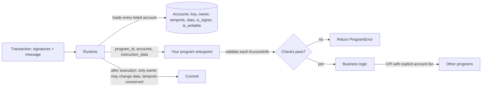

# The Solana Execution Model for Security People

Solana differs from the EVM in ways that change which bugs matter.

## Key differences

| Concept | EVM | Solana |
|---|---|---|
| Code and state | contract holds its own storage | programs are stateless; state lives in separate **accounts** |
| Who supplies state | contract reads its own storage | **caller passes every account** the instruction uses |
| Ownership | storage belongs to the contract | each account has an `owner` program; only the owner can modify data |
| Calls | `CALL`/`DELEGATECALL` | Cross-Program Invocation (CPI) with explicit account lists |
| Addresses derived by programs | `CREATE2` | Program Derived Addresses (PDAs) from seeds + bump |
| Upgrades | proxies | upgradeable loader with an upgrade authority |

## How an instruction reaches your code



The runtime enforces a few rules for you: only an account's owner program may modify its data or debit its lamports, total lamports are conserved, and signer and writable flags come from the transaction. Everything else, including whether the account passed as "config" is really your config, is your program's job.

## Consequence: validation is everything

Because the caller supplies accounts, a program must check that every account is the one it expects: right owner, right type, right PDA, signer where needed, writable where needed. Most Solana exploits are missing account checks. Anchor automates many checks through its `Accounts` derive; **native programs** (written directly against `solana_program` or newer SDKs, including high-performance frameworks like Pinocchio) must do it all by hand.

A useful mental model for EVM auditors: imagine a Solidity contract where every storage read is replaced by a function parameter supplied by the caller. Every one of those parameters must then be authenticated. That is a Solana instruction.

## Historic incidents (public reports)

| Year | Incident | Root cause (simplified) |
|---|---|---|
| 2022 | Wormhole (~120k ETH) | unverified sysvar account allowed fake signature verification |
| 2022 | Cashio (~US$48M) | incomplete validation chain of collateral accounts allowed fake collateral |
| 2022 | Crema Finance | fake account data accepted for a price tick account |

All three share a shape: the program read data from an account it had not authenticated, and the attacker supplied an account with chosen contents.

## Worked example

*Execution status: not executed in this book's CI; verify locally. Crate APIs (`solana-program`, `litesvm`) change between versions; adjust imports to the versions you install.*

We write a native instruction that trusts a "config" account without an owner check, then show in a LiteSVM test how an attacker passes a forged config.

**Step 1: the vulnerable program.**

```rust
use solana_program::{
    account_info::{next_account_info, AccountInfo}, entrypoint, entrypoint::ProgramResult,
    program_error::ProgramError, pubkey::Pubkey,
};

entrypoint!(process);

// Config layout: [0..32] admin pubkey
fn process(program_id: &Pubkey, accounts: &[AccountInfo], _data: &[u8]) -> ProgramResult {
    let it = &mut accounts.iter();
    let config = next_account_info(it)?;
    let caller = next_account_info(it)?;
    let vault  = next_account_info(it)?;
    let dest   = next_account_info(it)?;

    // BUG: no `config.owner == program_id` check, no discriminator, no PDA check
    let admin = Pubkey::new_from_array(config.data.borrow()[0..32].try_into().unwrap());
    if !caller.is_signer || *caller.key != admin {
        return Err(ProgramError::MissingRequiredSignature);
    }
    // admin-only: sweep the vault (vault is owned by this program)
    let amt = vault.lamports();
    **vault.try_borrow_mut_lamports()? -= amt;
    **dest.try_borrow_mut_lamports()? += amt;
    let _ = program_id;
    Ok(())
}
```

**Step 2: the forged account.** The attacker creates any account (owned by the System Program, or by a program they control) whose first 32 bytes are the attacker's own pubkey. In a LiteSVM test this is one call:

```rust
let fake_config = Pubkey::new_unique();
svm.set_account(fake_config, Account {
    lamports: 1_000_000, data: attacker.pubkey().to_bytes().to_vec(),
    owner: system_program::ID, executable: false, rent_epoch: 0,
}).unwrap();
```

On a real cluster the attacker would create it with an ordinary `create_account` instruction. Build the instruction with accounts `[fake_config, attacker (signer), vault (writable), attacker (writable)]`, send it, and assert the vault's lamports moved to the attacker. The test should pass, demonstrating the bug.

**Step 3: the fix.** Authenticate the config before reading it:

```rust
if config.owner != program_id { return Err(ProgramError::IncorrectProgramId); }
let (expected, _bump) = Pubkey::find_program_address(&[b"config"], program_id);
if *config.key != expected { return Err(ProgramError::InvalidSeeds); }
let data = config.data.borrow();
if data.len() < 40 || data[0..8] != CONFIG_DISCRIMINATOR { return Err(ProgramError::InvalidAccountData); }
let admin = Pubkey::new_from_array(data[8..40].try_into().unwrap());
```

Rerun: the forged config now fails with `IncorrectProgramId`. Keep both tests; the exploit test, inverted to expect failure, becomes a regression test.

**Step 4: compare with Anchor.** In Anchor the same account would be `#[account(seeds = [b"config"], bump)] pub config: Account<'info, Config>`. `Account<T>` checks the owner and the 8-byte discriminator; `seeds`/`bump` checks the PDA. Writing it natively shows how much those attributes do.

## Common pitfalls

- Reading data from any account before checking its owner.
- Checking the owner but not the type, so a different account kind owned by the same program is accepted.
- Checking `is_signer` on an account but never comparing its key to the stored authority.
- Assuming sysvar or program accounts are genuine without comparing their keys to the known IDs.
- Treating a published IDL as proof of which checks the deployed binary performs.

## Exercises

1. Write a native program instruction that reads a "config" account and forget the owner check. Exploit it with a fake account in a local test validator.
2. Compare the same instruction in Anchor and list the constraints Anchor adds.
3. Read the Cashio post-mortem and draw the validation chain that was incomplete.
4. Port the worked example to `solana-test-validator` and compare how long the exploit test takes versus LiteSVM.

## Further reading

- Solana docs, accounts and programs: <https://solana.com/docs/core>
- Sealevel attacks: <https://github.com/coral-xyz/sealevel-attacks>
- Neodyme, "Solana Smart Contracts: Common Pitfalls and How to Avoid Them" (blog)
- LiteSVM: <https://github.com/LiteSVM/litesvm>
