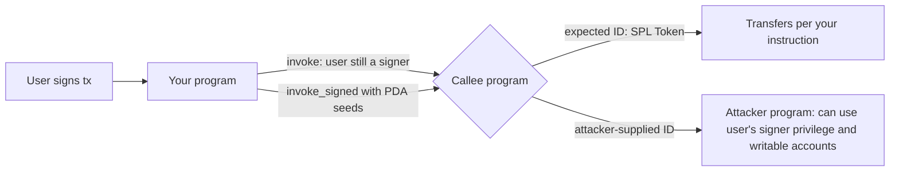

# CPI and PDA Security

Cross-Program Invocation (CPI) is how Solana programs compose: one program calls another with an explicit list of accounts. Program Derived Addresses (PDAs) are how programs own accounts and sign for them. Both are powerful, and both are where authority leaks.

## Cross-Program Invocation risks

- **Arbitrary CPI:** invoking a program ID supplied by the caller. The attacker passes their own program that pretends to be the token program. Always check `program.key` against the expected ID.
- **Signer privilege extension:** accounts that signed the outer instruction remain signers in the CPI. Invoking an untrusted program with a user's signer account lets that program act as the user.
- **PDA signing (`invoke_signed`):** your program can sign for its PDAs. If seeds are not specific enough, one user's PDA can sign for another's resources.
- **Reloading after CPI:** account data read before a CPI may be stale afterwards; deserialise again after the call.
- **Reentrancy:** Solana limits direct self-reentrancy, but CPI chains can still produce surprising orderings; reason about state at each call.



The privilege that flows into a CPI is the union of the outer transaction's signers and any PDAs you sign for. Whatever program you call receives all of it for the accounts you pass.

## PDA seed design

Seeds must include **every identifier** that distinguishes resources:

```
vault PDA seeds = ["vault", pool_id, user_pubkey]   // good
vault PDA seeds = ["vault", user_pubkey]            // collides across pools
```

Also include a type prefix to avoid collisions between different account kinds.

Two further rules. Store the canonical bump (from `find_program_address`) when the account is created and reuse it, rather than accepting a bump from instruction data. And beware variable-length seeds placed next to each other: `["ab", "c"]` and `["a", "bc"]` concatenate to the same bytes. Use fixed-length seeds (pubkeys, `u64::to_le_bytes`) or a separator scheme you control.

## Worked example

*Execution status: not executed in this book's CI; verify locally. Function signatures follow `solana-program` and `spl-token`; check them against the versions you install.*

We fix an arbitrary-CPI bug and a PDA seed collision in a toy staking program.

**Step 1: arbitrary CPI.**

```rust
// accounts: [user (signer), user_token, pool_vault, token_program]
let token_program = next_account_info(it)?;
// BUG: token_program.key is never checked
let ix = spl_token::instruction::transfer(
    token_program.key, user_token.key, pool_vault.key, user.key, &[], amount,
)?;
invoke(&ix, &[user_token.clone(), pool_vault.clone(), user.clone(), token_program.clone()])?;
credit_stake(user.key, amount)?;   // credited even though nothing was transferred
```

The attacker deploys a program that accepts any instruction and returns `Ok(())`, passes its ID as `token_program`, and is credited with stake for free. In a LiteSVM test, add the attacker's no-op program with `svm.add_program`, send the instruction, and assert the stake record increased while `pool_vault`'s token balance did not.

Fix:

```rust
if *token_program.key != spl_token::ID { return Err(ProgramError::IncorrectProgramId); }
```

If the program should also accept Token-2022, compare against both IDs explicitly and handle its extensions; do not accept "any program".

**Step 2: verify the effect, not the call.** Even with the right program, check the result. Read `pool_vault`'s token amount before and after the CPI (unpack `spl_token::state::Account` from its data again after the call) and credit the difference. This also handles transfer-fee tokens correctly.

**Step 3: seed collision.** Suppose user vaults are PDAs with seeds `[b"vault", user]`, and the program supports multiple pools. A user who deposits into pool A and pool B gets the *same* vault address, so pool B's withdraw instruction can sign for funds deposited via pool A:

```rust
let (vault, bump) = Pubkey::find_program_address(&[b"vault", user.as_ref()], program_id);
```

Test: deposit 100 into pool A, then withdraw 100 via pool B, which has no deposit record for this user but signs with the same PDA. If pool B's accounting only checks the vault's balance, the withdrawal succeeds. Fix the seeds to `[b"vault", pool.as_ref(), user.as_ref()]`, migrate existing accounts, and rerun: the two pools now derive different vaults.

**Step 4: signer pass-through.** Find every `invoke` that passes a user signer account to a program other than a fixed, known one (System, Token, Associated Token). Each is a place where the callee could act as the user. Remove the signer from the account list or restrict the callee.

## Common pitfalls

- Using a program ID from the accounts list without comparing it to a constant.
- Crediting users based on the instruction's `amount` rather than the measured balance change.
- PDA seeds missing the pool, mint or market identifier.
- Accepting user-supplied bumps.
- Reading account data before a CPI and trusting it afterwards.
- Passing user signers or writable accounts to callees that do not need them.

## Exercises

1. Write an instruction with arbitrary CPI and exploit it with a fake token program in a local validator.
2. Show a PDA seed collision across two pools and fix it.
3. Demonstrate stale data after a CPI that modifies a shared account.
4. Construct two different variable-length seed lists that derive the same PDA, and redesign the seeds so this is impossible.

## Further reading

- Solana CPI docs: <https://solana.com/docs/core/cpi>
- Solana PDA docs: <https://solana.com/docs/core/pda>
- Neodyme blog: <https://neodyme.io/en/blog/>
- SPL Token instruction builders: <https://docs.rs/spl-token>
