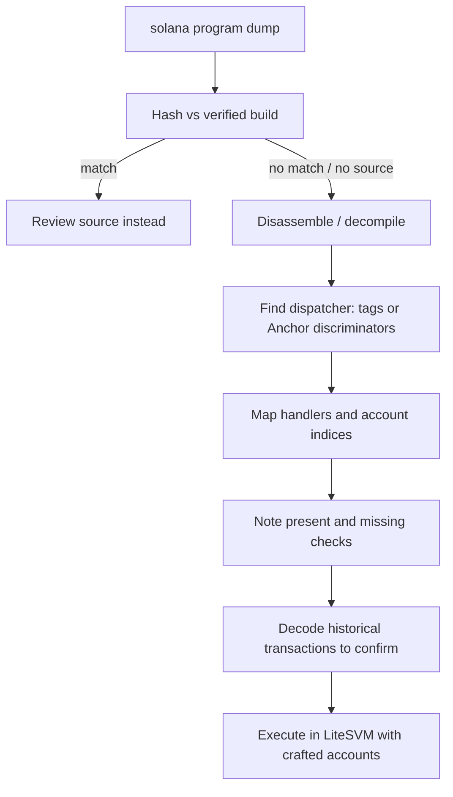

# Reversing Solana Programs (sBPF)

Many Solana programs are not open source, or the deployed binary may differ from published source. Reversing is needed for audits, incident response and malware analysis.

## Verifying source matches deployment

Solana supports **verifiable builds**: build the program in a deterministic Docker environment and compare the hash with the on-chain program data. Tools: `solana-verify` and related registries/APIs. Always check before trusting a source review.

Also check the **upgrade authority**. A verified build tells you what is deployed now; if an upgrade authority exists, the code can change tomorrow. `solana program show <PROGRAM_ID>` prints it.

## Tooling for unverified binaries

| Tool | Use |
|---|---|
| `solana program dump` | fetch the deployed ELF |
| `llvm-objdump` with BPF target | disassembly |
| Ghidra with an eBPF/sBPF processor module | decompilation (community modules) |
| Binary Ninja / IDA plugins | community sBPF support |
| Anchor IDL (if published on-chain) | instruction and account layouts |

## Reversing approach

1. Identify the **entrypoint** and instruction dispatcher (often a match on the first byte(s) or an 8-byte Anchor discriminator: `sha256("global:<name>")[..8]`).
2. Map instruction handlers and the accounts each reads/writes.
3. Look for account checks (owner comparisons, `is_signer` reads) and note their absence.
4. Cross-check with real transactions: decode instruction data of historical calls.



AI assistance helps renaming and summarising decompiled handlers; verify every claim against transaction history or local execution (see **ai-reverse-engineering-pipelines**).

## Worked example

*Execution status: the discriminator values were computed with Python's `hashlib` when this chapter was written. The Solana CLI and disassembly commands were not executed in this book's CI; verify locally.*

We confirm a program's deployment, then map its dispatcher using Anchor discriminators.

**Step 1: dump and inspect.**

```bash
solana program show $PROGRAM_ID --url mainnet-beta     # upgrade authority, data length
solana program dump $PROGRAM_ID prog.so --url mainnet-beta
sha256sum prog.so
```

If the project publishes a verified build, compare with `solana-verify get-program-hash $PROGRAM_ID` and the hash of a local `solana-verify build`. A mismatch means the source you have is not what runs.

**Step 2: compute discriminators.** If the program is Anchor-based, its instruction dispatcher compares the first 8 bytes of instruction data against `sha256("global:<name>")[..8]`, and account types begin with `sha256("account:<Name>")[..8]`:

```python
import hashlib
for n in ["global:initialize", "global:withdraw", "account:Vault"]:
    print(n, hashlib.sha256(n.encode()).digest()[:8].hex())
```

Output:

```text
global:initialize afaf6d1f0d989bed
global:withdraw b712469c946da122
account:Vault d308e82b02987577
```

Search the disassembly for these constants. On sBPF they typically appear as 64-bit immediates (`lddw`) compared against the loaded instruction prefix, in little-endian order. Each match marks a handler entry. Guess names from the protocol's UI and docs, hash them, and look for the result; unmatched constants are instructions you have not named yet.

**Step 3: disassemble.**

```bash
llvm-objdump -d --triple=bpfel prog.so > prog.asm
grep -n "lddw" prog.asm | head
```

Newer sBPF versions add instructions that generic BPF disassemblers may not decode; if output looks wrong, use a disassembler that tracks the current sBPF spec.

**Step 4: confirm with history.** Pull recent transactions for the program (`solana transaction-history` or an RPC `getSignaturesForAddress` call), decode each instruction's first 8 bytes, and count calls per discriminator. A handler you think is admin-only but that random wallets call successfully is a lead worth reproducing.

**Step 5: execute locally.** Load `prog.so` into LiteSVM with `add_program`, craft accounts as Chapter 1 shows, and call the handler you suspect lacks an owner check. A successful call with a forged account is evidence; a decompiler's pseudo-C is not.

## Common pitfalls

- Reviewing GitHub source without verifying it matches the deployed binary.
- Ignoring the upgrade authority after verifying a build.
- Trusting decompiler output, especially for 64-bit immediates and stack-relative accesses.
- Assuming an on-chain IDL is complete or current; it is published separately from the code.
- Forgetting endianness when searching for discriminator constants.
- Letting an AI-written handler summary stand without a transaction or local execution confirming it.

## Exercises

1. Build a program verifiably and compare the hash with an on-chain deployment you control.
2. Dump an open-source program, disassemble it, and match the dispatcher to the source.
3. Compute Anchor discriminators for a program's instructions and decode historical transactions.
4. For a program with an upgrade authority, find its last upgrade transaction and diff the old and new binaries' handler lists.

## Further reading

- solana-verify: <https://github.com/Ellipsis-Labs/solana-verifiable-build>
- Solana CLI program commands: <https://solana.com/docs/programs/deploying>
- Anchor IDL docs: <https://www.anchor-lang.com>
- sBPF virtual machine and instruction set: <https://github.com/anza-xyz/sbpf>
