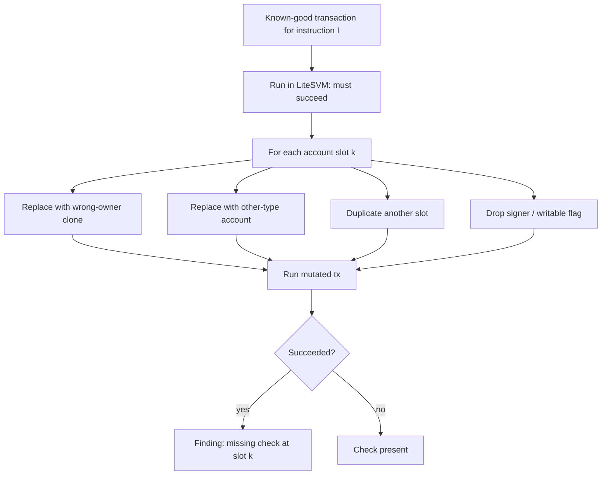

# Fuzzing and Testing Solana Programs

Solana's account model makes one class of test unusually productive: substitute accounts and check that the program refuses. This chapter covers test environments, fuzzing approaches and a concrete account-substitution harness.

## Test environments

| Tool | Speed | Fidelity |
|---|---|---|
| `solana-test-validator` | slow | full validator |
| LiteSVM / Mollusk-style lightweight SVMs | fast | program execution without full validator |
| BanksClient (program-test) | medium | in-process runtime |

Fast in-process SVMs make fuzzing practical.

Use the fast SVM for fuzzing and per-commit CI, and `solana-test-validator` for a smaller set of end-to-end tests that exercise things the lightweight SVMs may not model (for example compute-budget behaviour, transaction size limits or specific sysvars). Disagreements between the two are bugs in your harness assumptions until proven otherwise.

## Fuzzing approaches

- **Trident:** a fuzzing framework for Anchor programs that generates instruction sequences and account inputs.
- **cargo-fuzz** on instruction handlers with a lightweight SVM harness.
- **Account fuzzing:** for each instruction, substitute each account with: a fake account of the right size, an account with a different owner, the same account twice, a non-canonical PDA. Assert the instruction fails. This systematically tests the validation checklist from Chapter 2.



## Invariants

As on the EVM, write invariants: token conservation across the program's vaults, user balances never exceed deposits, admin-only state changes.

## Building a regression corpus

Every bug found by fuzzing or audit should become a regression test: the exact instruction, accounts and data that triggered it. Keep these in the repository and run them in CI against the fast in-process SVM. For account-substitution tests, generate the substitutions automatically from the instruction's account list so new instructions get coverage by default. This turns the Chapter 2 checklist into executable, always-on checks.

## Worked example

*Execution status: not executed in this book's CI; verify locally. The LiteSVM calls follow its documented API at the time of writing; method names may differ between releases.*

We build the account-substitution harness from the diagram for the `withdraw` instruction of Chapter 2, using LiteSVM.

**Step 1: a known-good baseline.**

```rust
fn baseline(svm: &mut LiteSVM, ctx: &Fixture) -> Instruction {
    Instruction {
        program_id: ctx.program_id,
        accounts: vec![
            AccountMeta::new(ctx.vault, false),
            AccountMeta::new(ctx.user_record, false),
            AccountMeta::new_readonly(ctx.alice.pubkey(), true),
        ],
        data: withdraw_data(10),
    }
}
```

Assert that sending it succeeds. A substitution harness without a passing baseline only proves that broken transactions fail.

**Step 2: mutations.**

```rust
enum Mutation { WrongOwner, OtherType, DuplicateOf(usize), DropSigner, DropWritable }

fn apply(svm: &mut LiteSVM, ix: &mut Instruction, k: usize, m: &Mutation, ctx: &Fixture) {
    match m {
        Mutation::WrongOwner => {
            // clone slot k's account data under a different owner at a fresh address
            let mut acc = svm.get_account(&ix.accounts[k].pubkey).unwrap_or_default();
            acc.owner = system_program::ID;
            let fake = Pubkey::new_unique();
            svm.set_account(fake, acc).unwrap();
            ix.accounts[k].pubkey = fake;
        }
        Mutation::OtherType      => ix.accounts[k].pubkey = ctx.some_other_type_account,
        Mutation::DuplicateOf(j) => ix.accounts[k].pubkey = ix.accounts[*j].pubkey,
        Mutation::DropSigner     => ix.accounts[k].is_signer = false,
        Mutation::DropWritable   => ix.accounts[k].is_writable = false,
    }
}
```

`DropSigner` also requires building the transaction without that signer's signature; handle it when assembling the transaction.

**Step 3: the loop.** For each slot `k` and each mutation that applies, rebuild a fresh `LiteSVM` from the fixture, apply the mutation, send, and record whether it succeeded. Print a matrix:

```text
slot           WrongOwner OtherType Dup(0) Dup(1) DropSigner DropWritable
0 vault        rejected   rejected  -      rej    n/a        rejected
1 user_record  rejected   rejected  rej    -      n/a        rejected
2 signer       n/a        n/a       rej    rej    rejected   n/a
```

That table is what a correct program should produce. Now delete the discriminator check from `load()` in Chapter 2's code and rerun: the `OtherType` cell for slot 0 should flip to `ACCEPTED`. Planting a bug and watching the harness catch it is how you know the harness works.

**Step 4: make it permanent.** Generate the mutation list from each instruction's account metadata so new instructions are covered automatically. Fail CI on any `ACCEPTED` cell that is not explicitly allow-listed with a comment explaining why (for example, an account that is intentionally unchecked because it is only logged).

**Step 5: go further with coverage-guided fuzzing.** Feed random instruction data and account choices from a small pool (valid accounts, mutated accounts) into the same harness under `cargo fuzz`, and assert invariants after each run: total lamports and token balances in the program's vaults equal the sum of user records. When AI tools suggest new invariants, add them as assertions and let the fuzzer test them; an invariant that never fails on a planted bug is not checking anything.

## Common pitfalls

- No passing baseline, so every mutated transaction fails for unrelated reasons.
- Reusing SVM state across mutations, so one test's side effects hide another's result.
- Mutating only the obvious accounts (vaults) and not program, sysvar and token accounts.
- Fuzzing instruction data while always passing correct accounts, missing the dominant bug class.
- Coverage-guided fuzzing without invariants, which only finds panics.
- Never planting a bug to confirm the harness detects it.

## Exercises

1. Write an account-substitution fuzzer for one instruction and find a missing check in a deliberately buggy program.
2. Run Trident on an Anchor example program.
3. Implement a conservation invariant across a vault program's operations.
4. Add a `NonCanonicalBump` mutation that derives the PDA with a different valid bump and confirm the program rejects it.

## Further reading

- Trident: <https://github.com/Ackee-Blockchain/trident>
- LiteSVM: <https://github.com/LiteSVM/litesvm>
- cargo-fuzz: <https://github.com/rust-fuzz/cargo-fuzz>
- Mollusk (lightweight SVM test harness): <https://github.com/anza-xyz/mollusk>
