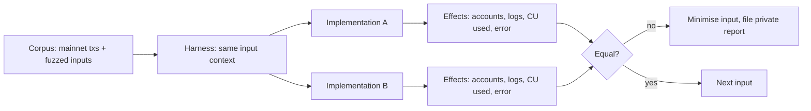

# Validator Client Security

Solana's security also depends on its validator clients. Agave (the Anza-maintained client descended from the original Solana Labs code) and Firedancer (Jump Crypto's independent implementation, with Frankendancer as a hybrid) form the beginnings of client diversity.

## Why client diversity matters

A bug in a single-client network can halt or fork the chain. With two independent implementations, differential testing becomes possible, and a bug in one client may not take down the network. Solana has experienced several outages historically, some due to resource exhaustion under transaction floods.

Diversity cuts both ways. If two clients each hold a large share of stake and disagree about the result of a transaction, the network can split rather than halt. The security goal is not only "two clients" but "two clients that agree on every valid input", which is exactly what differential testing measures.

## Areas of risk

- **Runtime (SVM) divergence:** two clients executing the same transaction differently (state hash mismatch).
- **sBPF VM bugs:** JIT and interpreter differences; memory safety in the VM.
- **Networking:** QUIC-based transaction ingestion, gossip, turbine block propagation; DoS resistance.
- **Consensus:** fork choice, vote processing.

| Layer | Example question | Typical evidence |
|---|---|---|
| SVM / runtime | do both clients compute the same account states and fees? | differential replay of transactions |
| sBPF VM | do interpreter and JIT agree on every program and input? | VM-level differential fuzzing |
| Networking | can a peer exhaust memory or CPU with crafted packets? | protocol fuzzing, load tests |
| Consensus | do clients choose the same fork under adversarial votes? | simulation, cluster tests |

## Differential testing

Run transaction corpora and fuzzed inputs through both clients' runtimes and compare resulting account states. Firedancer's team and others have published work on conformance testing; this is a strong area for security research and fits distributed compute (see **decentralized-security-compute** Chapter 7).



The comparison must cover everything consensus depends on: resulting account data and lamports, error codes, and compute units consumed. Comparing only success or failure misses divergences that would still split the network.

## Disclosure

Validator bugs are critical infrastructure issues. Report to the client teams' security contacts and the relevant bug bounty programmes before any publication.

## Worked example

*Execution status: partly executed. The two fee functions were compiled with rustc 1.96 (edition 2021) and run on one hand-picked input, which printed `Some(28000000005000) None`, confirming the divergence. The `cargo fuzz` run was not executed in this book's CI; verify locally.*

Real client conformance testing needs each client's harness. The method, however, is easy to practise on a small, self-contained target: two implementations of the same consensus-relevant calculation. We use a simplified fee function.

**Step 1: two implementations.** Imagine a reference implementation and an optimised rewrite of "fee = base fee per signature × signatures + prioritisation fee, where prioritisation fee = ceil(compute_unit_limit × micro_lamports_per_cu / 1 000 000)":

```rust
pub fn fee_ref(sigs: u64, base: u64, cu_limit: u64, price: u64) -> Option<u64> {
    let prio = (cu_limit as u128 * price as u128 + 999_999) / 1_000_000;
    let total = sigs as u128 * base as u128 + prio;
    u64::try_from(total).ok()
}

pub fn fee_fast(sigs: u64, base: u64, cu_limit: u64, price: u64) -> Option<u64> {
    let prio = cu_limit.checked_mul(price)?.div_ceil(1_000_000);   // BUG: u64 overflow path
    sigs.checked_mul(base)?.checked_add(prio)
}
```

Both "look right". For example, with 1 signature, base fee 5 000, a 1 400 000 CU limit and a price of 20 000 000 000 000 micro-lamports per CU, `fee_ref` returns `Some(28000000005000)` and `fee_fast` returns `None`. They differ when `cu_limit × price` overflows `u64` but the final fee would still fit after division: the reference returns `Some(fee)`, the fast version returns `None` (transaction rejected).

**Step 2: a differential fuzz target.** With `cargo fuzz`:

```rust
#![no_main]
use libfuzzer_sys::fuzz_target;
fuzz_target!(|d: (u64, u64, u64, u64)| {
    let (s, b, c, p) = (d.0 % 128, d.1 % 100_000, d.2, d.3);
    assert_eq!(fee_ref(s, b, c, p), fee_fast(s, b, c, p), "divergence: {:?}", d);
});
```

Run `cargo fuzz run fee_diff`. A coverage-guided fuzzer should find a divergent input quickly because the overflow boundary is a simple comparison. Minimise it with `cargo fuzz tmin` and keep it as a regression test.

**Step 3: decide which is right.** Differential testing finds disagreement, not truth. Here the specification decides: if the protocol defines the fee using 128-bit intermediate arithmetic, `fee_fast` is wrong; if it defines rejection on overflow, `fee_ref` is wrong. In real client work, Agave's behaviour has historically served as the de facto reference, and any divergence is resolved against the agreed specification before either client changes.

**Step 4: scale up.** The same structure applies to whole-transaction execution: a harness feeds identical account state and instruction into each client's runtime, then compares effects. Firedancer's public conformance tooling and test vectors (see the firedancer-io GitHub organisation) are a starting point. Any divergence found against mainnet clients is a potential network-splitting bug: report it privately and do not publish the input.

## Common pitfalls

- Comparing only success or failure, not full effects and compute units.
- Treating one client as automatically correct without checking the specification.
- Fuzzing with inputs that never reach boundary conditions (overflow, maximum sizes, empty inputs).
- Publishing a divergent input before both client teams have patched and validators have upgraded.
- Ignoring networking and resource-exhaustion paths, historically a significant source of outages.

## Exercises

1. Read the Firedancer documentation on conformance testing and summarise the approach.
2. Build a tiny differential harness comparing two sBPF interpreters (e.g. different versions) on random programs.
3. Review a historical Solana outage report and classify the root cause.
4. Run the worked example's fuzz target, minimise the first divergence, and write the specification sentence that resolves it.

## Further reading

- Agave: <https://github.com/anza-xyz/agave>
- Firedancer: <https://github.com/firedancer-io/firedancer>
- Solana status history and outage reports: <https://status.solana.com>
- cargo-fuzz book: <https://rust-fuzz.github.io/book/cargo-fuzz.html>
